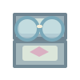
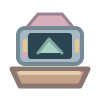
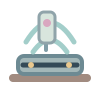
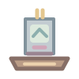
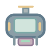
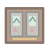
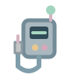

# 35K Alchemy V76 · First 50 original SVG subjects

These are the actual source files at native 35 px and enlarged 90 px. View carefully for silhouettes, subject match and contrast before final approval.

| # | Element | 35 px | 90 px |
|---:|---|:---:|:---:|
| 1 | Game Boy Screen Magnifier |  |  |
| 2 | Game Boy Link Station |  |  |
| 3 | Game Boy Camera Album |  |  |
| 4 | Game Boy Color Shell Workshop |  |  |
| 5 | Game Boy Advance Power Cradle |  |  |
| 6 | Nintendo DS Stylus Dock |  |  |
| 7 | Nintendo DSi Photo Studio |  |  |
| 8 | Nintendo 3DS Parallax Viewer |  |  |
| 9 | Nintendo Switch Travel Dock |  |  |
| 10 | Nintendo Switch OLED Showcase |  |  |
| 11 | Nintendo Switch 2 Cartridge Case |  |  |
| 12 | Famicom Cartridge Organizer |  |  |
| 13 | Super Famicom Controller Tray |  |  |
| 14 | Nintendo 64 Repair Station |  |  |
| 15 | Nintendo 64 Expansion Tester |  |  |
| 16 | GameCube Disc Display |  |  |
| 17 | Wii Motion Calibration Station |  |  |
| 18 | Wii U Charging Mat |  |  |
| 19 | PlayStation Disc Organizer |  |  |
| 20 | PlayStation 2 Memory Cabinet |  |  |
| 21 | PlayStation 3 Cooling Platform |  |  |
| 22 | PlayStation 4 Dual Charging Dock |  |  |
| 23 | PlayStation 5 Vertical Cooling Stand |  |  |
| 24 | PlayStation Portal Travel Sleeve |  |  |
| 25 | Xbox Disc Tower |  |  |
| 26 | Xbox 360 Power Module |  |  |
| 27 | Xbox One Wireless Receiver |  |  |
| 28 | Xbox Series X Ventilation Grille |  |  |
| 29 | Dreamcast VMU Display Stand |  |  |
| 30 | Dreamcast Controller Shell |  |  |
| 31 | Sega Genesis Cartridge Display |  |  |
| 32 | Sega Saturn Repair Bench |  |  |
| 33 | Sega Game Gear Power Bank |  |  |
| 34 | Sega Nomad Headphone Adapter |  |  |
| 35 | Game and Watch Gallery |  |  |
| 36 | Famicom Disk Archive |  |  |
| 37 | Nintendo 64 Rumble Tester |  |  |
| 38 | Game Boy Printer Scrapbook |  |  |
| 39 | Game Boy Link Cable Tester |  |  |
| 40 | 3DS Tabletop Stand |  |  |
| 41 | Arcade Control Panel |  |  |
| 42 | Fighting Cabinet Twin Controls |  |  |
| 43 | Racing Arcade Dashboard |  |  |
| 44 | Pinball Score Lamp |  |  |
| 45 | Arcade Coin Collector |  |  |
| 46 | Pixel Animation Drawing Desk |  |  |
| 47 | Retro Console Diagnostic Screen |  |  |
| 48 | Retro Rhythm Oscilloscope |  |  |
| 49 | Co-op Controller Rack |  |  |
| 50 | Portable Game Repair Mat |  |  |
