# Alchemy 10K — V82: 200 original SVG sources (QA candidate)

**Content count complete: 200/200**, consisting of **93 Mythology & Gods and 107 Prehistory & Dinosaurs elements**, 200 new global A+B pairs and 200 separate `client/assets/v82/*.svg` source files. This is **not yet a published build**. 120 sources have separately authored subject drawings; the subsequent 80 prehistoric animal illustrations are drawn from distinct taxonomic anatomy parameters with body, skull, frill, tail, feathers, wings and horns varied to match the actual subject. Art map and source SVG remain identical.

**Review instructions:** compare every item at 35px (the real inventory scale) and 90px; inspect recognizable silhouette, anatomy, visual variety, legibility in Light/Dark themes and mobile 320/360/390 px widths. Automated SVG syntax and duplicate-source gates do not replace real device review or human art clearance. A screenshot/phone pass is still pending.

**Target candidate:** 6,012 unique elements and 14,349 global recipes (5,812/14,149 historical plus exactly 200). Automated complete-suite and Android debug verification still pending. Direct selected-source closure checks: Mythology **109/109**, Prehistory **116/116**, Nature **476/476**, People **211/211**.

## Mythology & Gods (93)

| Discovery | Main recipe inputs | 35px | 90px |
|---|---|---|---|
| **[Mythology](../client/assets/v82/mythology.svg)** | `pack:god` + `pack:legend` |  |  |
| **[Greek Pantheon](../client/assets/v82/greek-pantheon.svg)** | Mythology + `organic41:ancient-city` |  |  |
| **[Mount Olympus](../client/assets/v82/mount-olympus.svg)** | Greek Pantheon + `legacy:65` |  |  |
| **[Divine Thunderbolt](../client/assets/v82/divine-thunderbolt.svg)** | Mythology + `legacy:125` |  |  |
| **[Zeus](../client/assets/v82/zeus.svg)** | Mount Olympus + Divine Thunderbolt |  |  |
| **[Sacred Trident](../client/assets/v82/sacred-trident.svg)** | Greek Pantheon + `legacy:125` |  |  |
| **[Poseidon](../client/assets/v82/poseidon.svg)** | Mount Olympus + Sacred Trident |  |  |
| **[Ancient Wisdom](../client/assets/v82/ancient-wisdom.svg)** | Mythology + `pack:psychic` |  |  |
| **[Athena](../client/assets/v82/athena.svg)** | Greek Pantheon + Ancient Wisdom |  |  |
| **[Roman Pantheon](../client/assets/v82/roman-pantheon.svg)** | Greek Pantheon + `legacy:48` |  |  |
| **[Jupiter](../client/assets/v82/jupiter.svg)** | Roman Pantheon + Divine Thunderbolt |  |  |
| **[Norse Mythology](../client/assets/v82/norse-mythology.svg)** | Mythology + `legacy:586` |  |  |
| **[Asgard](../client/assets/v82/asgard.svg)** | Norse Mythology + `legacy:65` |  |  |
| **[Runestone](../client/assets/v82/runestone.svg)** | Norse Mythology + `legacy:64` | 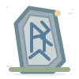 |  |
| **[Odin](../client/assets/v82/odin.svg)** | Asgard + Runestone |  |  |
| **[Norse War Hammer](../client/assets/v82/norse-war-hammer.svg)** | Norse Mythology + Divine Thunderbolt |  |  |
| **[Thor of Asgard](../client/assets/v82/thor-of-asgard.svg)** | Asgard + Norse War Hammer |  |  |
| **[Loki of Asgard](../client/assets/v82/loki-of-asgard.svg)** | Asgard + `pack:shapeshifter` |  |  |
| **[Hera](../client/assets/v82/hera.svg)** | Zeus + Greek Pantheon | 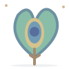 |  |
| **[Demeter](../client/assets/v82/demeter.svg)** | Mount Olympus + Ancient Wisdom |  |  |
| **[Apollo](../client/assets/v82/apollo.svg)** | Divine Thunderbolt + Greek Pantheon |  |  |
| **[Artemis](../client/assets/v82/artemis.svg)** | Apollo + Mythology | 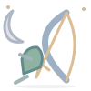 |  |
| **[Ares](../client/assets/v82/ares.svg)** | Athena + Divine Thunderbolt | 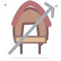 |  |
| **[Aphrodite](../client/assets/v82/aphrodite.svg)** | Poseidon + Greek Pantheon |  |  |
| **[Hephaestus](../client/assets/v82/hephaestus.svg)** | Zeus + Divine Thunderbolt |  |  |
| **[Hermes](../client/assets/v82/hermes.svg)** | Greek Pantheon + `pack:leader` | 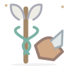 |  |
| **[Greek Underworld](../client/assets/v82/greek-underworld.svg)** | Greek Pantheon + `pack:psychic` |  |  |
| **[Hades the God](../client/assets/v82/hades.svg)** | Zeus + Greek Underworld |  |  |
| **[Dionysus](../client/assets/v82/dionysus.svg)** | Greek Pantheon + `pack:transformation` |  |  |
| **[Persephone](../client/assets/v82/persephone.svg)** | Hades the God + Demeter |  |  |
| **[Gaia](../client/assets/v82/gaia.svg)** | Greek Pantheon + Mythology |  |  |
| **[Cronus](../client/assets/v82/cronus.svg)** | Gaia + Greek Pantheon | 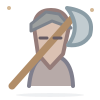 |  |
| **[Cerberus](../client/assets/v82/cerberus.svg)** | Greek Underworld + `pack:shapeshifter` | 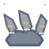 |  |
| **[Minotaur](../client/assets/v82/minotaur.svg)** | Greek Pantheon + `pack:shapeshifter` | 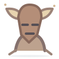 |  |
| **[Pegasus](../client/assets/v82/pegasus.svg)** | Poseidon + `pack:shapeshifter` |  |  |
| **[Medusa](../client/assets/v82/medusa.svg)** | Poseidon + Athena |  |  |
| **[Cyclops](../client/assets/v82/cyclops.svg)** | Ancient Wisdom + `pack:shapeshifter` |  |  |
| **[Juno](../client/assets/v82/juno.svg)** | Jupiter + Hera |  |  |
| **[Neptune](../client/assets/v82/neptune.svg)** | Roman Pantheon + Poseidon |  |  |
| **[Minerva](../client/assets/v82/minerva.svg)** | Roman Pantheon + Athena |  |  |
| **[Mars the War God](../client/assets/v82/mars-the-war-god.svg)** | Roman Pantheon + Ares |  |  |
| **[Venus the Goddess](../client/assets/v82/venus-the-goddess.svg)** | Roman Pantheon + Aphrodite |  |  |
| **[Mercury the Messenger](../client/assets/v82/mercury-the-messenger.svg)** | Roman Pantheon + Hermes |  |  |
| **[Diana of the Hunt](../client/assets/v82/diana-of-the-hunt.svg)** | Roman Pantheon + Artemis | 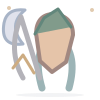 |  |
| **[Vulcan the Smith](../client/assets/v82/vulcan-the-smith.svg)** | Roman Pantheon + Hephaestus | 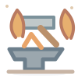 |  |
| **[Ceres the Harvest](../client/assets/v82/ceres-the-harvest.svg)** | Roman Pantheon + Demeter |  |  |
| **[Pluto the Underworld God](../client/assets/v82/pluto-the-underworld-god.svg)** | Roman Pantheon + Hades the God |  |  |
| **[Saturn the Titan](../client/assets/v82/saturn-the-titan.svg)** | Roman Pantheon + Cronus | 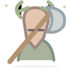 |  |
| **[Janus](../client/assets/v82/janus.svg)** | Roman Pantheon + Ancient Wisdom |  |  |
| **[Bacchus](../client/assets/v82/bacchus.svg)** | Roman Pantheon + Dionysus |  |  |
| **[Sacred Hearth](../client/assets/v82/sacred-hearth.svg)** | Roman Pantheon + Gaia |  |  |
| **[Vesta](../client/assets/v82/vesta.svg)** | Roman Pantheon + Sacred Hearth |  |  |
| **[Roman Augur](../client/assets/v82/roman-augur.svg)** | Jupiter + Ancient Wisdom |  |  |
| **[Temple of Vesta](../client/assets/v82/temple-of-vesta.svg)** | Vesta + Roman Pantheon |  |  |
| **[Yggdrasil](../client/assets/v82/yggdrasil.svg)** | Asgard + Norse Mythology |  |  |
| **[Bifrost](../client/assets/v82/bifrost.svg)** | Asgard + Divine Thunderbolt |  |  |
| **[Midgard](../client/assets/v82/midgard.svg)** | Norse Mythology + Ancient Wisdom |  |  |
| **[Nine Realms](../client/assets/v82/nine-realms.svg)** | Yggdrasil + Norse Mythology |  |  |
| **[Valhalla](../client/assets/v82/valhalla.svg)** | Odin + Yggdrasil |  |  |
| **[Valkyrie](../client/assets/v82/valkyrie.svg)** | Valhalla + Norse War Hammer |  |  |
| **[Ragnarok](../client/assets/v82/ragnarok.svg)** | Loki of Asgard + Thor of Asgard |  |  |
| **[Fenrir](../client/assets/v82/fenrir.svg)** | Loki of Asgard + `pack:shapeshifter` |  |  |
| **[Jormungandr](../client/assets/v82/jormungandr.svg)** | Loki of Asgard + Norse Mythology |  |  |
| **[Sleipnir](../client/assets/v82/sleipnir.svg)** | Odin + `pack:shapeshifter` | 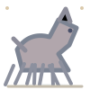 |  |
| **[Frigg](../client/assets/v82/frigg.svg)** | Odin + Asgard |  |  |
| **[Freyja](../client/assets/v82/freyja.svg)** | Asgard + Ancient Wisdom |  |  |
| **[Freyr](../client/assets/v82/freyr.svg)** | Freyja + Asgard |  |  |
| **[Tyr the Oathkeeper](../client/assets/v82/tyr-the-oathkeeper.svg)** | Odin + Norse War Hammer |  |  |
| **[Heimdall](../client/assets/v82/heimdall.svg)** | Bifrost + Asgard |  |  |
| **[Baldr](../client/assets/v82/baldr.svg)** | Frigg + Asgard |  |  |
| **[Niflheim](../client/assets/v82/niflheim.svg)** | Nine Realms + Runestone |  |  |
| **[Hel](../client/assets/v82/hel.svg)** | Loki of Asgard + Niflheim |  |  |
| **[Jotunheim](../client/assets/v82/jotunheim.svg)** | Nine Realms + `pack:shapeshifter` |  |  |
| **[Frost Giant](../client/assets/v82/frost-giant.svg)** | Jotunheim + Norse Mythology |  |  |
| **[Gungnir](../client/assets/v82/gungnir.svg)** | Odin + Runestone | 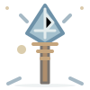 |  |
| **[Egyptian Mythology](../client/assets/v82/egyptian-mythology.svg)** | Mythology + Greek Underworld | 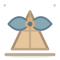 |  |
| **[Ancient Egypt](../client/assets/v82/ancient-egypt.svg)** | Egyptian Mythology + `organic41:ancient-city` |  |  |
| **[Egyptian Pantheon](../client/assets/v82/egyptian-pantheon.svg)** | Egyptian Mythology + `pack:god` |  |  |
| **[Ra](../client/assets/v82/ra.svg)** | Egyptian Pantheon + Divine Thunderbolt |  |  |
| **[Isis](../client/assets/v82/isis.svg)** | Egyptian Pantheon + Ancient Wisdom |  |  |
| **[Osiris](../client/assets/v82/osiris.svg)** | Egyptian Pantheon + Greek Underworld | 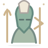 |  |
| **[Horus](../client/assets/v82/horus.svg)** | Ra + Isis |  |  |
| **[Anubis](../client/assets/v82/anubis.svg)** | Osiris + `pack:shapeshifter` | 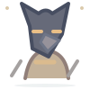 |  |
| **[Bastet](../client/assets/v82/bastet.svg)** | Isis + `pack:shapeshifter` |  |  |
| **[Thoth](../client/assets/v82/thoth.svg)** | Egyptian Pantheon + Runestone |  |  |
| **[Set of Egypt](../client/assets/v82/set-of-egypt.svg)** | Egyptian Pantheon + Ragnarok | 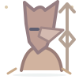 |  |
| **[Hathor](../client/assets/v82/hathor.svg)** | Egyptian Pantheon + Aphrodite |  |  |
| **[Sekhmet](../client/assets/v82/sekhmet.svg)** | Ra + `pack:shapeshifter` |  |  |
| **[Sobek](../client/assets/v82/sobek.svg)** | Egyptian Pantheon + Poseidon |  |  |
| **[Nephthys](../client/assets/v82/nephthys.svg)** | Isis + Greek Underworld |  |  |
| **[Ammit](../client/assets/v82/ammit.svg)** | Anubis + `pack:shapeshifter` | 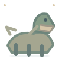 |  |
| **[Apophis](../client/assets/v82/apophis.svg)** | Ra + Jormungandr |  |  |
| **[Eye of Horus](../client/assets/v82/eye-of-horus.svg)** | Horus + Ancient Wisdom | 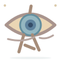 |  |

## Prehistory & Dinosaurs (107)

| Discovery | Main recipe inputs | 35px | 90px |
|---|---|---|---|
| **[Mesozoic Era](../client/assets/v82/mesozoic-era.svg)** | `legacy:575` + `legacy:64` |  |  |
| **[Jurassic Period](../client/assets/v82/jurassic-period.svg)** | Mesozoic Era + `legacy:21` | 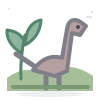 |  |
| **[Cretaceous Period](../client/assets/v82/cretaceous-period.svg)** | Mesozoic Era + `legacy:26` | 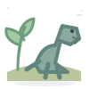 |  |
| **[Fossil Skeleton](../client/assets/v82/fossil-skeleton.svg)** | `legacy:41` + `legacy:580` |  |  |
| **[Dinosaur Armor](../client/assets/v82/dinosaur-armor.svg)** | `legacy:575` + `legacy:14` |  |  |
| **[Stegosaurus](../client/assets/v82/stegosaurus.svg)** | Jurassic Period + Dinosaur Armor | 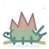 |  |
| **[Ankylosaurus](../client/assets/v82/ankylosaurus.svg)** | Cretaceous Period + Dinosaur Armor | 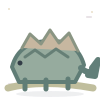 |  |
| **[Geological Timeline](../client/assets/v82/geological-timeline.svg)** | Mesozoic Era + Fossil Skeleton |  |  |
| **[Paleozoic Era](../client/assets/v82/paleozoic-era.svg)** | Geological Timeline + Fossil Skeleton |  |  |
| **[Cenozoic Era](../client/assets/v82/cenozoic-era.svg)** | Geological Timeline + Mesozoic Era |  |  |
| **[Triassic Period](../client/assets/v82/triassic-period.svg)** | Mesozoic Era + Dinosaur Armor | 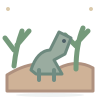 |  |
| **[Late Cretaceous](../client/assets/v82/late-cretaceous.svg)** | Cretaceous Period + Mesozoic Era | 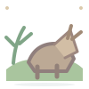 |  |
| **[Pleistocene Epoch](../client/assets/v82/pleistocene-epoch.svg)** | Cenozoic Era + Fossil Skeleton | 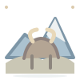 |  |
| **[Ice Age](../client/assets/v82/ice-age.svg)** | Pleistocene Epoch + Fossil Skeleton |  |  |
| **[Cambrian Period](../client/assets/v82/cambrian-period.svg)** | Paleozoic Era + Geological Timeline |  |  |
| **[Carboniferous Period](../client/assets/v82/carboniferous-period.svg)** | Paleozoic Era + Fossil Skeleton |  |  |
| **[Prehistoric Ocean](../client/assets/v82/prehistoric-ocean.svg)** | Mesozoic Era + Paleozoic Era |  |  |
| **[Theropod](../client/assets/v82/theropod.svg)** | Cretaceous Period + Triassic Period | 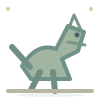 |  |
| **[Sauropod](../client/assets/v82/sauropod.svg)** | Jurassic Period + Mesozoic Era | 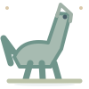 |  |
| **[Ceratopsian](../client/assets/v82/ceratopsian.svg)** | Late Cretaceous + Dinosaur Armor | 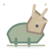 |  |
| **[Hadrosaur](../client/assets/v82/hadrosaur.svg)** | Late Cretaceous + Mesozoic Era | 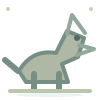 |  |
| **[Feathered Dinosaur](../client/assets/v82/feathered-dinosaur.svg)** | Theropod + Fossil Skeleton | 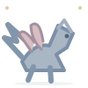 |  |
| **[Pterosaur](../client/assets/v82/pterosaur.svg)** | Triassic Period + Fossil Skeleton |  |  |
| **[Marine Reptile](../client/assets/v82/marine-reptile.svg)** | Prehistoric Ocean + Jurassic Period |  |  |
| **[Prehistoric Mammal](../client/assets/v82/prehistoric-mammal.svg)** | Cenozoic Era + Geological Timeline | 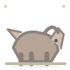 |  |
| **[Fossilized Dinosaur Egg](../client/assets/v82/dinosaur-egg.svg)** | Jurassic Period + Fossil Skeleton |  |  |
| **[Fossil Footprint](../client/assets/v82/fossil-footprint.svg)** | Stegosaurus + Fossil Skeleton | 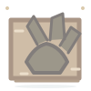 |  |
| **[Allosaurus](../client/assets/v82/allosaurus.svg)** | Theropod + Jurassic Period | 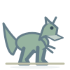 |  |
| **[Spinosaurus](../client/assets/v82/spinosaurus.svg)** | Theropod + Marine Reptile | 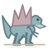 |  |
| **[Carnotaurus](../client/assets/v82/carnotaurus.svg)** | Theropod + Dinosaur Armor | 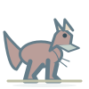 |  |
| **[Giganotosaurus](../client/assets/v82/giganotosaurus.svg)** | Theropod + Late Cretaceous | 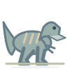 |  |
| **[Tarbosaurus](../client/assets/v82/tarbosaurus.svg)** | Giganotosaurus + Theropod | 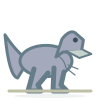 |  |
| **[Dilophosaurus](../client/assets/v82/dilophosaurus.svg)** | Allosaurus + Theropod | 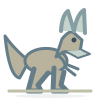 |  |
| **[Baryonyx](../client/assets/v82/baryonyx.svg)** | Spinosaurus + Theropod | 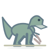 |  |
| **[Deinonychus](../client/assets/v82/deinonychus.svg)** | Feathered Dinosaur + Theropod | 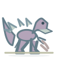 |  |
| **[Oviraptor](../client/assets/v82/oviraptor.svg)** | Fossilized Dinosaur Egg + Theropod | 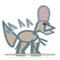 |  |
| **[Compsognathus](../client/assets/v82/compsognathus.svg)** | Theropod + Fossil Footprint | 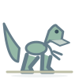 |  |
| **[Utahraptor](../client/assets/v82/utahraptor.svg)** | Deinonychus + Feathered Dinosaur | 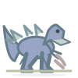 |  |
| **[Ceratosaurus](../client/assets/v82/ceratosaurus.svg)** | Allosaurus + Dinosaur Armor | 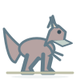 |  |
| **[Suchomimus](../client/assets/v82/suchomimus.svg)** | Spinosaurus + Marine Reptile | 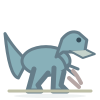 |  |
| **[Albertosaurus](../client/assets/v82/albertosaurus.svg)** | Tarbosaurus + Theropod | 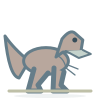 |  |
| **[Ornithomimus](../client/assets/v82/ornithomimus.svg)** | Feathered Dinosaur + Fossil Footprint | 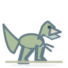 |  |
| **[Therizinosaurus](../client/assets/v82/therizinosaurus.svg)** | Feathered Dinosaur + Dinosaur Armor | 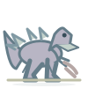 |  |
| **[Brachiosaurus](../client/assets/v82/brachiosaurus.svg)** | Sauropod + Jurassic Period | 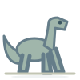 |  |
| **[Diplodocus](../client/assets/v82/diplodocus.svg)** | Sauropod + Fossil Footprint |  |  |
| **[Apatosaurus](../client/assets/v82/apatosaurus.svg)** | Brachiosaurus + Sauropod |  |  |
| **[Argentinosaurus](../client/assets/v82/argentinosaurus.svg)** | Sauropod + Late Cretaceous |  |  |
| **[Dreadnoughtus](../client/assets/v82/dreadnoughtus.svg)** | Argentinosaurus + Sauropod |  |  |
| **[Camarasaurus](../client/assets/v82/camarasaurus.svg)** | Apatosaurus + Jurassic Period |  |  |
| **[Saltasaurus](../client/assets/v82/saltasaurus.svg)** | Sauropod + Dinosaur Armor |  |  |
| **[Mamenchisaurus](../client/assets/v82/mamenchisaurus.svg)** | Diplodocus + Jurassic Period |  |  |
| **[Amargasaurus](../client/assets/v82/amargasaurus.svg)** | Sauropod + Fossil Skeleton |  |  |
| **[Brontosaurus](../client/assets/v82/brontosaurus.svg)** | Apatosaurus + Diplodocus |  |  |
| **[Triceratops](../client/assets/v82/triceratops.svg)** | Ceratopsian + Late Cretaceous |  |  |
| **[Styracosaurus](../client/assets/v82/styracosaurus.svg)** | Triceratops + Ceratopsian |  |  |
| **[Protoceratops](../client/assets/v82/protoceratops.svg)** | Ceratopsian + Fossilized Dinosaur Egg |  |  |
| **[Pachyrhinosaurus](../client/assets/v82/pachyrhinosaurus.svg)** | Ceratopsian + Dinosaur Armor |  |  |
| **[Centrosaurus](../client/assets/v82/centrosaurus.svg)** | Styracosaurus + Ceratopsian |  |  |
| **[Pentaceratops](../client/assets/v82/pentaceratops.svg)** | Ceratopsian + Fossil Skeleton |  |  |
| **[Chasmosaurus](../client/assets/v82/chasmosaurus.svg)** | Ceratopsian + Fossil Footprint |  |  |
| **[Parasaurolophus](../client/assets/v82/parasaurolophus.svg)** | Hadrosaur + Late Cretaceous |  |  |
| **[Corythosaurus](../client/assets/v82/corythosaurus.svg)** | Parasaurolophus + Hadrosaur |  |  |
| **[Edmontosaurus](../client/assets/v82/edmontosaurus.svg)** | Hadrosaur + Fossilized Dinosaur Egg |  |  |
| **[Lambeosaurus](../client/assets/v82/lambeosaurus.svg)** | Corythosaurus + Hadrosaur |  |  |
| **[Maiasaura](../client/assets/v82/maiasaura.svg)** | Edmontosaurus + Fossilized Dinosaur Egg |  |  |
| **[Kentrosaurus](../client/assets/v82/kentrosaurus.svg)** | Stegosaurus + Dinosaur Armor |  |  |
| **[Huayangosaurus](../client/assets/v82/huayangosaurus.svg)** | Stegosaurus + Jurassic Period |  |  |
| **[Euoplocephalus](../client/assets/v82/euoplocephalus.svg)** | Ankylosaurus + Dinosaur Armor |  |  |
| **[Nodosaurus](../client/assets/v82/nodosaurus.svg)** | Dinosaur Armor + Fossil Footprint |  |  |
| **[Borealopelta](../client/assets/v82/borealopelta.svg)** | Nodosaurus + Dinosaur Armor |  |  |
| **[Pachycephalosaurus](../client/assets/v82/pachycephalosaurus.svg)** | Dinosaur Armor + Geological Timeline |  |  |
| **[Microraptor](../client/assets/v82/microraptor.svg)** | Feathered Dinosaur + Jurassic Period |  |  |
| **[Archaeopteryx](../client/assets/v82/archaeopteryx.svg)** | Feathered Dinosaur + Fossilized Dinosaur Egg |  |  |
| **[Psittacosaurus](../client/assets/v82/psittacosaurus.svg)** | Ceratopsian + Cretaceous Period |  |  |
| **[Plateosaurus](../client/assets/v82/plateosaurus.svg)** | Sauropod + Triassic Period |  |  |
| **[Iguanodon](../client/assets/v82/iguanodon.svg)** | Hadrosaur + Jurassic Period |  |  |
| **[Gallimimus](../client/assets/v82/gallimimus.svg)** | Ornithomimus + Theropod |  |  |
| **[Pteranodon](../client/assets/v82/pteranodon.svg)** | Pterosaur + Cretaceous Period |  |  |
| **[Quetzalcoatlus](../client/assets/v82/quetzalcoatlus.svg)** | Pterosaur + Late Cretaceous |  |  |
| **[Pterodactylus](../client/assets/v82/pterodactylus.svg)** | Pterosaur + Jurassic Period |  |  |
| **[Dimorphodon](../client/assets/v82/dimorphodon.svg)** | Pterosaur + Fossil Skeleton |  |  |
| **[Rhamphorhynchus](../client/assets/v82/rhamphorhynchus.svg)** | Pterosaur + Fossil Footprint |  |  |
| **[Tapejara](../client/assets/v82/tapejara.svg)** | Pterosaur + Quetzalcoatlus |  |  |
| **[Mosasaurus](../client/assets/v82/mosasaurus.svg)** | Marine Reptile + Late Cretaceous |  |  |
| **[Plesiosaurus](../client/assets/v82/plesiosaurus.svg)** | Marine Reptile + Jurassic Period |  |  |
| **[Elasmosaurus](../client/assets/v82/elasmosaurus.svg)** | Plesiosaurus + Cretaceous Period |  |  |
| **[Ichthyosaurus](../client/assets/v82/ichthyosaurus.svg)** | Marine Reptile + Triassic Period |  |  |
| **[Liopleurodon](../client/assets/v82/liopleurodon.svg)** | Marine Reptile + Plesiosaurus |  |  |
| **[Kronosaurus](../client/assets/v82/kronosaurus.svg)** | Liopleurodon + Cretaceous Period |  |  |
| **[Nothosaurus](../client/assets/v82/nothosaurus.svg)** | Marine Reptile + Mesozoic Era |  |  |
| **[Woolly Mammoth](../client/assets/v82/woolly-mammoth.svg)** | Prehistoric Mammal + Ice Age |  |  |
| **[Smilodon](../client/assets/v82/smilodon.svg)** | Prehistoric Mammal + Pleistocene Epoch |  |  |
| **[Woolly Rhinoceros](../client/assets/v82/woolly-rhinoceros.svg)** | Ice Age + Fossil Skeleton |  |  |
| **[Giant Ground Sloth](../client/assets/v82/giant-ground-sloth.svg)** | Prehistoric Mammal + Cenozoic Era |  |  |
| **[Cave Bear](../client/assets/v82/cave-bear.svg)** | Woolly Mammoth + Ice Age |  |  |
| **[Irish Elk](../client/assets/v82/irish-elk.svg)** | Prehistoric Mammal + Fossil Footprint |  |  |
| **[Dire Wolf](../client/assets/v82/dire-wolf.svg)** | Cave Bear + Ice Age |  |  |
| **[Glyptodon](../client/assets/v82/glyptodon.svg)** | Prehistoric Mammal + Dinosaur Armor |  |  |
| **[Mastodon](../client/assets/v82/mastodon.svg)** | Woolly Mammoth + Prehistoric Mammal |  |  |
| **[Terror Bird](../client/assets/v82/terror-bird.svg)** | Cenozoic Era + Feathered Dinosaur |  |  |
| **[Trilobite](../client/assets/v82/trilobite.svg)** | Cambrian Period + Prehistoric Ocean |  |  |
| **[Ammonite](../client/assets/v82/ammonite.svg)** | Prehistoric Ocean + Fossil Skeleton |  |  |
| **[Anomalocaris](../client/assets/v82/anomalocaris.svg)** | Cambrian Period + Trilobite |  |  |
| **[Dunkleosteus](../client/assets/v82/dunkleosteus.svg)** | Paleozoic Era + Prehistoric Ocean |  |  |
| **[Megalodon](../client/assets/v82/megalodon.svg)** | Cenozoic Era + Prehistoric Ocean |  |  |
| **[Giant Dragonfly](../client/assets/v82/giant-dragonfly.svg)** | Carboniferous Period + Fossil Footprint |  |  |
| **[Cycad](../client/assets/v82/cycad.svg)** | Jurassic Period + Paleozoic Era |  |  |

## Provenance and next checks

- Runtime SVG map: [`client/src/organic-art-v82.js`](../client/src/organic-art-v82.js), checked against all SVG source files.
- New IDs and globally shared recipes: [`client/src/organic-pack-v82.js`](../client/src/organic-pack-v82.js).
- Original authoring blueprints and species-specific anatomy renderer: [`tools/v82-fauna-renderer.js`](../tools/v82-fauna-renderer.js) and the Greek/Roman/Norse/Egyptian/prehistoric source files in `tools/`.
- Test and build gates: [`tools/validate-v82.mjs`](../tools/validate-v82.mjs), [`tools/audit-v82-art.py`](../tools/audit-v82-art.py), [`client/test/v82-content.test.mjs`](../client/test/v82-content.test.mjs).

**Pending:** execute full Node and Python audits locally/on CI, review all 200 thumbnails on an Android device, test on a real phone and generate a single debug APK only after the gates pass.
