# Alchemy 10K — V83 WIP artwork review (150/200)

The 100 WIP SVG sources are individually authored and have separate source paths, but visual similarity/readability **has not been signed off**. The 50 mythological candidates keep the independent family at 159/159 reachable members, while the 50 game-related candidates remain Classic-only. Full npm/CI, runtime comparison and real-device 35px review are still pending. Assess Light/Dark readability and distinguishable silhouettes at 35px; 90px is diagnostic only.

| Candidate | Proposed global ingredients | 35px | 90px |
|---|---|---|---|
| Mythic Bestiary | `organic82:mythology` + `pack:shapeshifter` |  |  |
| Cave Troll | `organic83:mythic-bestiary` + `organic82:jotunheim` | 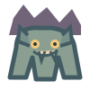 |  |
| Stone Troll | `organic83:cave-troll` + `organic82:runestone` | 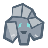 |  |
| Forest Troll | `organic83:cave-troll` + `organic82:yggdrasil` | 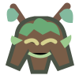 |  |
| Ulfhednar | `organic82:fenrir` + `pack:shapeshifter` | 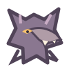 |  |
| Vrykolakas | `organic83:mythic-bestiary` + `organic82:greek-underworld` |  |  |
| Vampire Bat | `organic83:vrykolakas` + `pack:shapeshifter` | 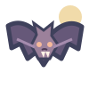 |  |
| Night Wraith | `organic83:mythic-bestiary` + `organic82:niflheim` |  |  |
| Banshee | `organic83:night-wraith` + `organic82:valkyrie` |  |  |
| Stone Golem | `organic82:hephaestus` + `organic82:runestone` | 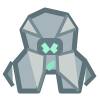 |  |
| Forest Dryad | `organic82:gaia` + `organic82:yggdrasil` | 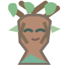 |  |
| Basilisk | `organic82:medusa` + `organic82:jormungandr` | 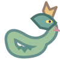 |  |

| Griffin | `organic82:horus` + `organic82:cerberus` | 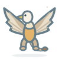 |  |
| Chimera | `organic82:cerberus` + `organic82:pegasus` | 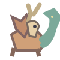 |  |
| Harpy | `organic82:valkyrie` + `organic82:medusa` | 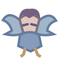 |  |
| Centaur | `organic82:pegasus` + `organic82:minotaur` | 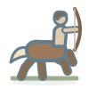 |  |
| Satyr | `organic82:dionysus` + `organic82:minotaur` | 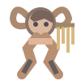 |  |
| Ocean Leviathan | `organic82:poseidon` + `organic82:jormungandr` | 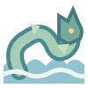 |  |
| Selkie | `organic83:mythic-bestiary` + `organic82:poseidon` | 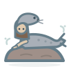 |  |
| Solar Phoenix | `organic82:ra` + `organic82:ragnarok` | 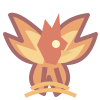 |  |
| Thunderbird | `organic82:thor-of-asgard` + `organic82:horus` | 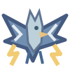 |  |
| Giant Roc | `organic82:horus` + `organic82:frost-giant` | 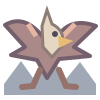 |  |
| Ancient Tree Ent | `organic83:forest-dryad` + `organic82:frost-giant` | 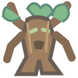 |  |
| Will-o'-the-Wisp | `organic83:night-wraith` + `organic82:ra` |  |  |
| Gargoyle | `organic83:stone-golem` + `organic82:cerberus` | 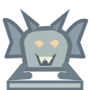 |  |

| Kelpie | `organic83:ocean-leviathan` + `organic83:centaur` | 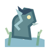 |  |
| Barghest | `organic82:fenrir` + `organic83:night-wraith` | 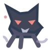 |  |
| Black Shuck | `organic83:barghest` + `organic82:niflheim` |  |  |
| Dullahan | `organic83:banshee` + `organic83:centaur` |  |  |
| Leshy | `organic83:forest-dryad` + `organic83:forest-troll` | 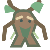 |  |
| Baba Yaga | `organic83:forest-dryad` + `organic83:night-wraith` | 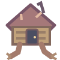 |  |
| Tatzelwurm | `organic83:basilisk` + `organic83:cave-troll` | 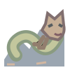 |  |
| Tarasque | `organic83:basilisk` + `organic83:stone-troll` | 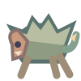 |  |
| Wyvern | `organic83:griffin` + `organic83:basilisk` | 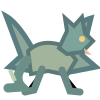 |  |
| Cockatrice | `organic83:thunderbird` + `organic83:basilisk` | 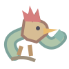 |  |
| Manticore | `organic83:chimera` + `organic83:basilisk` | 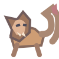 |  |
| Amphisbaena | `organic82:jormungandr` + `organic83:basilisk` | 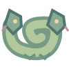 |  |
| Simurgh | `organic83:solar-phoenix` + `organic83:griffin` | 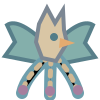 |  |

| Hippocampus | `organic83:selkie` + `organic83:centaur` |  |  |
| Naiad | `organic83:forest-dryad` + `organic83:ocean-leviathan` |  |  |
| Nereid | `organic83:naiad` + `organic82:poseidon` |  |  |
| Lamia | `organic82:medusa` + `organic83:vrykolakas` |  |  |
| Scylla | `organic83:ocean-leviathan` + `organic83:chimera` |  |  |
| Charybdis | `organic83:ocean-leviathan` + `organic83:scylla` |  |  |
| Fomorian | `organic82:frost-giant` + `organic83:ocean-leviathan` | 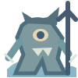 |  |
| Puca | `organic83:ulfhednar` + `organic83:selkie` | 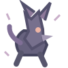 |  |
| Undine | `organic83:naiad` + `organic83:mythic-bestiary` |  |  |
| Pixie | `organic83:forest-dryad` + `organic83:will-o-wisp` | 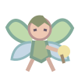 |  |
| Kobold | `organic83:cave-troll` + `organic83:mythic-bestiary` | 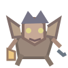 |  |
| Wight | `organic83:vrykolakas` + `organic83:night-wraith` |  |  |

| Quest Notice Board | `legacy:107` + `pack:system-quest` |  |  |
| Rune-Locked Door | `pack:dungeon-gate` + `organic82:runestone` |  |  |
| Checkpoint Banner | `legacy:361` + `legacy:107` | 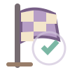 |  |
| Pixel Heart Pickup | `legacy:146` + `legacy:21` | 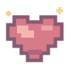 |  |
| Healing Campfire | `legacy:1` + `legacy:361` |  |  |
| Mana Flask | `legacy:125` + `legacy:23` |  |  |
| Treasure Mimic | `legacy:561` + `legacy:121` |  |  |
| Quest Compass | `pack:system-quest` + `legacy:354` |  |  |
| Dungeon Minimap | `pack:dungeon-gate` + `legacy:354` | 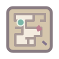 |  |
| Boss Health Bar | `legacy:357` + `legacy:76` |  |  |
| Loot Satchel | `legacy:561` + `legacy:29` | 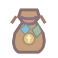 |  |
| Teleport Waystone | `legacy:361` + `organic82:runestone` |  |  |
| Skill Tree Diagram | `legacy:19` + `legacy:356` | 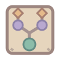 |  |
| Arcade Claw Machine | `legacy:172` + `legacy:561` |  |  |
| Prize Redemption Counter | `organic34:arcade-ticket` + `legacy:561` |  |  |
| Hidden Wall Lever | `legacy:29` + `pack:dungeon-gate` | 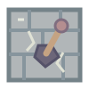 |  |
| Spike Trap Floor | `legacy:545` + `legacy:107` | 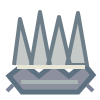 |  |
| Loot Rarity Gem | `legacy:34` + `legacy:561` | 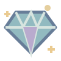 |  |
| Parry Spark | `legacy:545` + `legacy:18` |  |  |
| Save Crystal | `legacy:361` + `legacy:34` |  |  |
| Save Progress Meter | `legacy:361` + `legacy:76` |  |  |
| Secret Treasure Cache | `legacy:561` + `legacy:37` |  |  |
| Boss Arena Gate | `legacy:357` + `pack:dungeon-gate` | 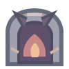 |  |
| Roguelite Relic | `legacy:237` + `pack:ancient-scroll` |  |  |
| Monster Bestiary Page | `organic83:mythic-bestiary` + `legacy:51` |  |  |

| Arcade Marquee Panel | `legacy:172` + `legacy:63` |  |  |
| Prize Capsule | `organic83:arcade-claw-machine` + `legacy:561` |  |  |
| Pinball Bumper | `legacy:172` + `legacy:22` |  |  |
| Pinball Launch Rail | `organic83:pinball-bumper` + `legacy:83` |  |  |
| Rhythm Note Lane | `organic83:arcade-marquee-panel` + `legacy:139` | 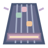 |  |
| Ghost Lap Stopwatch | `organic83:replay-ghost` + `legacy:210` |  |  |
| Replay Ghost | `organic83:checkpoint-banner` + `legacy:66` |  |  |
| Combo Counter | `organic83:boss-health-bar` + `legacy:96` |  |  |
| Boss Warning Siren | `organic83:boss-arena-gate` + `legacy:62` |  |  |
| Loot Drop Beacon | `organic83:treasure-mimic` + `legacy:63` |  |  |
| Inventory Tile Grid | `organic83:loot-satchel` + `legacy:76` | 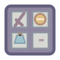 |  |
| Quick Access Ring | `organic83:skill-tree-diagram` + `legacy:83` | 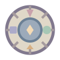 |  |
| Skill Point Token | `organic83:skill-tree-diagram` + `legacy:108` | 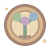 |  |
| Ability Cooldown Dial | `organic83:save-progress-meter` + `legacy:211` |  |  |
| Dialogue Choice Card | `organic83:quest-notice-board` + `legacy:106` |  |  |
| Side Quest Emblem | `organic83:quest-notice-board` + `legacy:354` |  |  |
| Pixel Damage Number | `organic83:pixel-heart-pickup` + `legacy:96` | 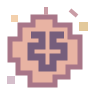 |  |
| Dungeon Fog Overlay | `organic83:dungeon-minimap` + `legacy:66` |  |  |
| Mini Boss Emblem | `organic83:boss-health-bar` + `legacy:561` | 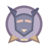 |  |
| Secret Switch Plate | `organic83:hidden-wall-lever` + `legacy:80` |  |  |
| Spike Warning Plaque | `organic83:spike-trap-floor` + `legacy:106` |  |  |
| Parry Training Dummy | `organic83:parry-spark` + `legacy:24` |  |  |
| Crafting Material Rack | `organic83:loot-satchel` + `legacy:22` |  |  |
| Teleport Anchor | `organic83:teleport-waystone` + `legacy:14` |  |  |
| Portal Lens | `organic83:teleport-waystone` + `legacy:23` |  |  |

| Arcade Token Hopper | `organic83:prize-redemption-counter` + `legacy:108` |  |  |
| Cabinet Coin Door | `organic83:arcade-marquee-panel` + `legacy:108` |  |  |
| Pinball Tilt Sensor | `organic83:pinball-bumper` + `legacy:86` |  |  |
| Rhythm Step Sensor | `organic83:rhythm-note-lane` + `legacy:116` |  |  |
| Prize Crane Joystick | `organic83:arcade-claw-machine` + `legacy:83` |  |  |
| Ticket Counting Tray | `organic83:prize-redemption-counter` + `legacy:96` |  |  |
| Cartridge Cleaning Swab | `legacy:151` + `organic83:crafting-material-rack` |  |  |
| Game Manual Foldout | `organic83:quest-notice-board` + `legacy:51` |  |  |
| Memory Card Sleeve | `legacy:337` + `organic83:inventory-tile-grid` |  |  |
| Controller Cable Reel | `legacy:68` + `organic83:quick-access-ring` |  |  |
| Handheld Dock Cable Stand | `legacy:169` + `organic83:controller-cable-reel` |  |  |
| Touchscreen Thumb Grip | `legacy:84` + `organic83:quick-access-ring` |  |  |
| Light Gun Holster | `legacy:327` + `organic83:loot-satchel` |  |  |
| Co-op Lobby Card | `legacy:365` + `organic83:quest-notice-board` |  |  |
| Party Game Scorepad | `organic83:combo-counter` + `legacy:107` |  |  |
| Dice Rolling Chute | `organic83:crafting-material-rack` + `legacy:223` |  |  |
| Dungeon Dice Set | `organic83:dungeon-minimap` + `legacy:223` |  |  |
| Miniature Paint Station | `legacy:1260` + `organic83:crafting-material-rack` |  |  |
| Map Tile Organizer | `organic83:dungeon-minimap` + `legacy:153` |  |  |
| Card Sleeve Binder | `legacy:163` + `organic83:inventory-tile-grid` |  |  |
| Board Game Storage Insert | `legacy:107` + `organic83:crafting-material-rack` |  |  |
| Pixel Sprite Flipbook | `legacy:219` + `organic83:monster-bestiary-page` |  |  |
| Platform Jump Spring | `organic83:pinball-launch-rail` + `legacy:356` |  |  |
| Puzzle Hint Dial | `legacy:224` + `organic83:quick-access-ring` |  |  |
| Boss Victory Banner | `organic83:boss-health-bar` + `organic83:checkpoint-banner` |  |  |

| Pangolin | `organic38:insect` + `organic83:stone-troll` |  |  |
| Fennec Fox | `organic40:fox` + `legacy:1048` |  |  |
| Shoebill | `organic38:bird` + `organic83:naiad` |  |  |
| Narwhal | `organic83:ocean-leviathan` + `legacy:35` |  |  |
| Wombat | `legacy:26` + `organic83:cave-troll` |  |  |
| Platypus | `organic83:selkie` + `organic38:bird` |  |  |
| Leafy Sea Dragon | `organic37:seahorse` + `organic83:forest-dryad` |  |  |
| Arctic Tern | `organic38:bird` + `organic38:iceberg` |  |  |
| Quokka | `legacy:558` + `legacy:26` |  |  |
| Musk Ox | `organic82:frost-giant` + `legacy:26` |  |  |
| Maned Wolf | `organic40:fox` + `organic83:barghest` |  |  |
| Saiga Antelope | `organic83:centaur` + `legacy:1048` |  |  |
| Aye-Aye | `legacy:601` + `legacy:142` |  |  |
| Okapi | `legacy:574` + `organic32:rainforest` |  |  |
| Blue-Ringed Octopus | `organic38:octopus` + `pack:venom` |  |  |
| Tardigrade | `legacy:26` + `organic32:microscope` |  |  |
| Proboscis Monkey | `legacy:601` + `legacy:39` |  |  |
| Giant Isopod | `organic38:crab` + `organic83:ocean-leviathan` |  |  |
| Binturong | `organic40:fox` + `legacy:19` |  |  |
| Secretary Bird | `organic38:bird` + `legacy:1048` |  |  |
| Sun Bear | `pack:panda` + `organic32:rainforest` |  |  |
| Gerenuk | `organic83:centaur` + `organic83:ancient-tree-ent` |  |  |
| Dumbo Octopus | `organic38:octopus` + `organic37:deep-sea` |  |  |
| Flying Fish | `legacy:27` + `organic38:bird` |  |  |
| Gila Monster | `legacy:1048` + `pack:venom` |  |  |
