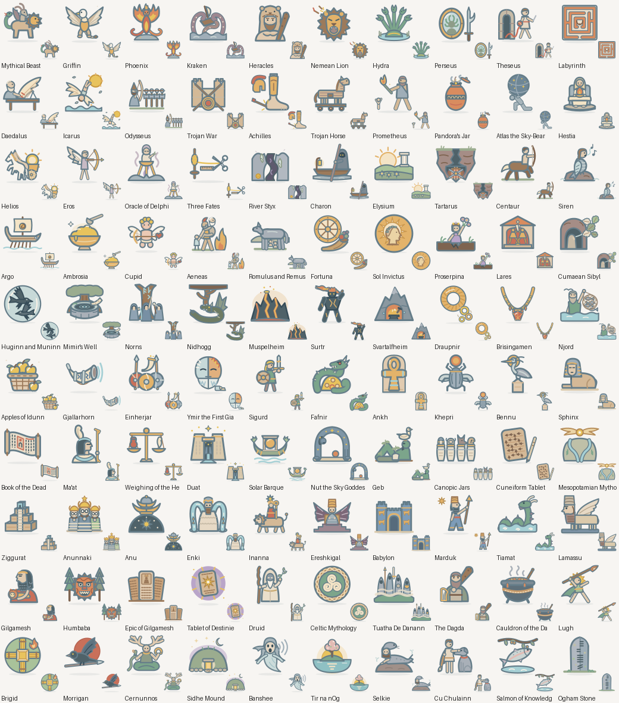
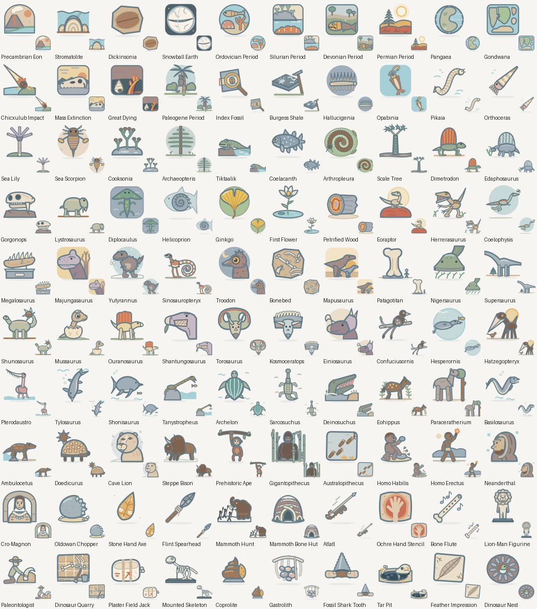

# Alchemy 10K — V83: +200 Mythology & Gods and Prehistory & Dinosaurs

**200/200 new elements**: 100 Mythology & Gods and 100 Prehistory & Dinosaurs, each with its own recipe, summary, witty discovery line and an original 100×100 SVG in `client/assets/v83/`. Catalog after V83: **6,212 elements**. Families: Mythology & Gods **209/209** and Prehistory & Dinosaurs **216/216**, each completable from its own four starters (checked by `tools/validate-v83.mjs` and in-game). 36 extra logical recipes for existing family elements (`tools/v83-alt-recipes.json`) do not count toward the 200.

**Art:** hand-authored per subject in the V82 house style (rounded `#657D89` outlines, muted pastels, ground shadow). `tools/audit-v83-art.py` found no exact or perceptual near-duplicates inside V83 or against V82. Five weak first drafts (Icarus, River Styx, Ymir, Anunnaki, Mesopotamian Mythology) were redrawn after review. Real-phone 35 px review in light and dark mode is still recommended.

New mythology branches: Mesopotamian (16) and Celtic (16), plus Greek, Roman, Norse and Egyptian depth. New prehistory branches: deep time and Earth history, Paleozoic life, plants, dinosaurs, pterosaurs and marine reptiles, Cenozoic mammals, early humans and Stone Age tools, fossils and palaeontology. Long-term plan to ~1,000 per family: `docs/V83_MYTH_PREHISTORY_LONG_TERM_PLAN.md`.

## Mythology & Gods (100)

| Element | Recipe | Discovery line |
|---|---|---|
| Mythical Beast | Fantasy + Shapeshifter | Assembled from spare parts of a dozen nightmares. |
| Griffin | Mythical Beast + Sky | Half king of beasts, half king of birds, fully in charge. |
| Phoenix | Mythical Beast + Sacred Hearth | Burns out, starts over, looks fantastic doing it. |
| Kraken | Mythical Beast + Poseidon | Calamari, but it orders you. |
| Heracles | Hero + Zeus | Twelve labours and still no day off. |
| Nemean Lion | Heracles + Mythical Beast | Arrows bounced off. So did the excuses. |
| Hydra | Cerberus + Medusa | Cut one off, get two. Terrible negotiating partner. |
| Perseus | Hero + Medusa | Never make eye contact. Use the shield. |
| Theseus | Hero + Minotaur | Navigation tip: always bring string. |
| Labyrinth | Minotaur + Ancient City | Every turn is the wrong one, by design. |
| Daedalus | Labyrinth + Human | Brilliant engineer. Terrible at safety briefings. |
| Icarus | Daedalus + Sky | Proof that altitude limits exist for a reason. |
| Odysseus | Hero + Cyclops | Name's Nobody. Remember that. |
| Trojan War | Ares + Ancient City | Ten years, one apple, zero chill. |
| Achilles | Hero + Trojan War | Invincible, terms and conditions apply to the heel. |
| Trojan Horse | Trojan War + Odysseus | Never accept a gift that requires a crane. |
| Prometheus | Human + Sacred Hearth | Brought fire to humans. Liver paid the bill. |
| Pandora's Jar | Prometheus + Zeus | Do not open. Seriously. Ok, hope survived. |
| Atlas the Sky-Bearer | Cronus + Sky | World's longest shift, no breaks. |
| Hestia | Sacred Hearth + Greek Pantheon | The goddess who keeps the home fires (and peace) burning. |
| Helios | Apollo + Sky | Daily commute: east to west, four fire horses. |
| Eros | Aphrodite + Human | One arrow, instant crush. |
| Oracle of Delphi | Apollo + Psychic | Answers guaranteed. Clarity not included. |
| Three Fates | Greek Pantheon + History | Spin, measure, snip. No refunds. |
| River Styx | Greek Underworld + Poseidon | Swimming not recommended. Ferry only. |
| Charon | River Styx + Human | Exact change only: one obol. |
| Elysium | Greek Underworld + Hero | Retirement plan for heroes. |
| Tartarus | Greek Underworld + Cronus | Titans checked in, never checked out. |
| Centaur | Human + Pegasus | Twice the legs, half the parking options. |
| Siren | Odysseus + Aphrodite | Great voice. Terrible venue. |
| Argo | Hero + Poseidon | Fifty heroes, one boat, endless arguments about rowing. |
| Ambrosia | Mount Olympus + Demeter | One bite and you never need a birthday again. |
| Cupid | Eros + Roman Pantheon | Small, winged, and armed with feelings. |
| Aeneas | Trojan War + Roman Pantheon | Lost a city, founded a civilisation. Net positive. |
| Romulus and Remus | Mars the War God + Ancient City | Raised by a wolf, founded an empire. Strong parenting. |
| Fortuna | Three Fates + Roman Pantheon | Spin the wheel. Results may vary. |
| Sol Invictus | Helios + Roman Pantheon | Unconquered, and very much unclouded. |
| Proserpina | Persephone + Roman Pantheon | Half the year in the dark, half in bloom. |
| Lares | Sacred Hearth + Clan | Tiny gods, big opinions about tidiness. |
| Cumaean Sibyl | Roman Augur + Oracle of Delphi | Prophecies delivered on leaves. Do not open the window. |
| Huginn and Muninn | Odin + Psychic | Two ravens, one inbox, full of world news. |
| Mimir's Well | Odin + Ancient Wisdom | Wisdom on tap. Price: one eye. |
| Norns | Yggdrasil + Three Fates | Past, present and future, carved in one tree trunk. |
| Nidhogg | Yggdrasil + Jormungandr | Eats roots. Destroys cosmology. Very rude. |
| Muspelheim | Nine Realms + Sacred Hearth | The realm where the thermostat is stuck on 'lava'. |
| Surtr | Muspelheim + Frost Giant | Brings a flaming sword to every party. |
| Svartalfheim | Nine Realms + Hephaestus | Underground forges. Best craftsmanship in nine worlds. |
| Draupnir | Svartalfheim + Odin | The original compound interest. |
| Brisingamen | Svartalfheim + Freyja | Four smiths, one necklace, one very determined goddess. |
| Njord | Freyja + Freyr | Patron of sailors, fishers and everyone who smells like the sea. |
| Apples of Idunn | Asgard + Ambrosia | An apple a day keeps Ragnarok... slightly further away. |
| Gjallarhorn | Heimdall + Ragnarok | The world's loudest alarm clock. Do not snooze. |
| Einherjar | Valhalla + Hero | Fight all day, feast all night, repeat until doomsday. |
| Ymir the First Giant | Niflheim + Muspelheim | Born from ice meeting fire. Very awkward family reunions. |
| Sigurd | Hero + Norse Mythology | Reforged sword, reformed dragon (it's dead). |
| Fafnir | Sigurd + Mythical Beast | Greed: turns you into a dragon, guaranteed. |
| Ankh | Ancient Egypt + Magic | The key to eternal life, in loop form. |
| Khepri | Ra + Transformation | Pushes the sun uphill every morning. Respect. |
| Bennu | Phoenix + Egyptian Mythology | The heron that inspired the phoenix's whole brand. |
| Sphinx | Ancient Egypt + Mythical Beast | Answer the riddle or wait another thousand years. |
| Book of the Dead | Thoth + Osiris | A travel guide for the afterlife. Five stars from the departed. |
| Ma'at | Egyptian Pantheon + Society | Truth, order and balance. Also, one excellent feather. |
| Weighing of the Heart | Anubis + Ma'at | Light heart: paradise. Heavy heart: snack for Ammit. |
| Duat | Ancient Egypt + Greek Underworld | Twelve hours of night, twelve gates, zero shortcuts. |
| Solar Barque | Ra + Duat | The sun commutes by boat. |
| Nut the Sky Goddess | Egyptian Pantheon + Sky | Literally holds up the night sky with a backbend. |
| Geb | Egyptian Pantheon + Gaia | The ground floor of Egyptian cosmology. |
| Canopic Jars | Anubis + Ancient Egypt | Four jars, four lids, one very organised afterlife. |
| Cuneiform Tablet | Ancient City + History | The first draft of history, written in mud. |
| Mesopotamian Mythology | Mythology + Cuneiform Tablet | Two rivers, a few thousand gods, the first epic. |
| Ziggurat | Mesopotamian Mythology + Ancient City | Stairway to heaven, mud-brick edition. |
| Anunnaki | Mesopotamian Mythology + God | The original council meeting, minutes in clay. |
| Anu | Anunnaki + Sky | Top of the sky, top of the family tree. |
| Enki | Anunnaki + Ancient Wisdom | Wise, crafty, and always has a fish on him. |
| Inanna | Anunnaki + Aphrodite | Love and war. Usually in that order. |
| Ereshkigal | Anunnaki + Greek Underworld | Queen of the land of no return. Visiting hours: none. |
| Babylon | Ziggurat + City | Big city, bright blue gates, legendary tower. |
| Marduk | Babylon + God | Babylon's champion, dragon-slayer and city manager. |
| Tiamat | Mesopotamian Mythology + Mythical Beast | Primordial chaos with a very long tail. |
| Lamassu | Babylon + Mythical Beast | Bull body, eagle wings, beard on fleek. |
| Gilgamesh | Hero + Mesopotamian Mythology | Two-thirds god, one-third hero, all ambition. |
| Humbaba | Gilgamesh + Mythical Beast | Cedar forest security: monstrous, effective. |
| Epic of Gilgamesh | Gilgamesh + Cuneiform Tablet | The world's oldest bestseller. Twelve tablets long. |
| Tablet of Destinies | Cuneiform Tablet + Three Fates | Whoever holds it writes the rules. |
| Druid | Clan + Ancient Wisdom | Knows every tree by name, and most of them by gossip. |
| Celtic Mythology | Druid + Mythology | Otherworlds, heroes, and a lot of clever knotwork. |
| Tuatha De Danann | Celtic Mythology + God | Arrived in a cloud of mist. Very dramatic entrance. |
| The Dagda | Tuatha De Danann + Leader | Club in one hand, harp in the other, dinner always ready. |
| Cauldron of the Dagda | The Dagda + Ambrosia | Bottomless soup. No one leaves hungry. |
| Lugh | Tuatha De Danann + Hero | Master of all crafts. Show-off of most. |
| Brigid | Tuatha De Danann + Sacred Hearth | Poetry, healing and blacksmithing. Overachiever. |
| Morrigan | Tuatha De Danann + Valkyrie | Shows up as a crow. You do not want that RSVP. |
| Cernunnos | Celtic Mythology + Mythical Beast | Antlers, torc and the respect of every deer in the forest. |
| Sidhe Mound | Tuatha De Danann + Ancient City | Looks like a hill. Is actually a party. |
| Banshee | Sidhe Mound + Human | Her singing voice is... a warning. |
| Tir na nOg | Celtic Mythology + Elysium | Land of eternal youth. No birthdays allowed. |
| Selkie | Celtic Mythology + Shapeshifter | Seal by day, dancer by night. Hides its coat carefully. |
| Cu Chulainn | Lugh + Hero | One hero, one ford, one very unlucky army. |
| Salmon of Knowledge | Celtic Mythology + Ancient Wisdom | Contains 100% of your daily wisdom. |
| Ogham Stone | Druid + Runestone | Early Irish text messages, carved in granite. |

## Prehistory & Dinosaurs (100)

| Element | Recipe | Discovery line |
|---|---|---|
| Precambrian Eon | Geological Timeline + Life | Four billion years of 'not much happening'. Allegedly. |
| Stromatolite | Precambrian Eon + Limestone | Earth's first skyscrapers, built by bacteria. |
| Dickinsonia | Precambrian Eon + Animal | A living bath mat, 560 million years ahead of fashion. |
| Snowball Earth | Precambrian Eon + Ice Age | The planet went fully frosted. Twice. |
| Ordovician Period | Geological Timeline + Cambrian Period | Seas full, land empty. Beach houses available. |
| Silurian Period | Geological Timeline + Ordovician Period | First plants step ashore. Very small steps. |
| Devonian Period | Geological Timeline + Silurian Period | The Age of Fishes. Fins were very in. |
| Permian Period | Geological Timeline + Carboniferous Period | Desert vibes, sail-backed neighbours. |
| Pangaea | Permian Period + Triassic Period | All the continents in one group chat. |
| Gondwana | Pangaea + Jurassic Period | South America and Africa used to be very close. |
| Chicxulub Impact | Late Cretaceous + Stone | Worst. Delivery. Ever. |
| Mass Extinction | Dinosaur + Chicxulub Impact | Nature pressed Ctrl+Alt+Delete. |
| Great Dying | Mass Extinction + Permian Period | Even worse than the one with the asteroid. |
| Paleogene Period | Cenozoic Era + Chicxulub Impact | Dinosaurs out. Mammals: 'Is this seat taken?' |
| Index Fossil | Geological Timeline + Trilobite | A fossil that doubles as a calendar. |
| Burgess Shale | Cambrian Period + Fossil | A rock library of weird Cambrian creatures. |
| Hallucigenia | Burgess Shale + Dinosaur Armor | Scientists drew it upside down at first. Fair. |
| Opabinia | Burgess Shale + Anomalocaris | Five eyes, one vacuum-cleaner nose. |
| Pikaia | Burgess Shale + Life | Your great-great-(x10 million) grandparent, maybe. |
| Orthoceras | Ordovician Period + Ammonite | Like an ammonite, but someone straightened it out. |
| Sea Lily | Ordovician Period + Limestone | An animal pretending very hard to be a flower. |
| Sea Scorpion | Silurian Period + Prehistoric Ocean | A scorpion the size of a person. Swimming. No thanks. |
| Cooksonia | Silurian Period + Life | The first lawn on Earth was 3 centimetres tall. |
| Archaeopteris | Devonian Period + Cooksonia | First tree. Invented shade. |
| Tiktaalik | Devonian Period + Fossil Footprint | Fish with ambitions. Mostly about walking. |
| Coelacanth | Devonian Period + Prehistoric Ocean | Declared extinct, then showed up at a fish market. |
| Arthropleura | Carboniferous Period + Trilobite | Two metres of legs. Count them if you dare. |
| Scale Tree | Carboniferous Period + Cycad | Grew fast, died young, became coal. |
| Dimetrodon | Permian Period + Spinosaurus | Not a dinosaur. Please stop putting it in dinosaur toy sets. |
| Edaphosaurus | Dimetrodon + Cycad | Same sail, vegetarian menu. |
| Gorgonops | Permian Period + Smilodon | Invented sabre teeth 250 million years before the cats. |
| Lystrosaurus | Triassic Period + Prehistoric Mammal | Survived the worst extinction ever by being aggressively average. |
| Diplocaulus | Permian Period + Tiktaalik | Head shaped like a boomerang. Still came back. |
| Helicoprion | Permian Period + Megalodon | Jaw like a buzz saw, fossil like a cinnamon roll. |
| Ginkgo | Cycad + Triassic Period | Outlived the dinosaurs. Still sheds leaves every autumn. |
| First Flower | Cretaceous Period + Cycad | Flowers arrive. Bees start planning. |
| Petrified Wood | Cycad + Stone | Wood that became so stressed it turned to stone. |
| Eoraptor | Dinosaur + Triassic Period | First at the dinosaur party. |
| Herrerasaurus | Eoraptor + Theropod | Triassic top dog, back when dinosaurs were the new kids. |
| Coelophysis | Theropod + Triassic Period | Built like a greyhound, ran in gangs. |
| Megalosaurus | Theropod + Fossil | Dinosaur number one, officially. |
| Majungasaurus | Carnotaurus + Theropod | Tiny arms, big attitude, Madagascar address. |
| Yutyrannus | Feathered Dinosaur + Tarbosaurus | Proof that big predators can be fluffy. |
| Sinosauropteryx | Feathered Dinosaur + Compsognathus | First feathered dinosaur, and colour-coordinated too. |
| Troodon | Feathered Dinosaur + Late Cretaceous | Big eyes, big brain, big plans after dark. |
| Bonebed | Fossil Skeleton + Fossil Skeleton | Where the herd ended up, all at once. |
| Mapusaurus | Giganotosaurus + Bonebed | Giant predator, possibly with a giant friend group. |
| Patagotitan | Argentinosaurus + Fossil Skeleton | Its thigh bone needs its own room. |
| Nigersaurus | Sauropod + Cretaceous Period | Nature's lawnmower, 500 teeth included. |
| Supersaurus | Diplodocus + Sauropod | Super long, super sauropod, super name. |
| Shunosaurus | Sauropod + Ankylosaurus | A sauropod that brought a mace. |
| Mussaurus | Plateosaurus + Fossilized Dinosaur Egg | Named after its baby photos. |
| Ouranosaurus | Iguanodon + Spinosaurus | Iguanodon body, sail-back accessory pack. |
| Shantungosaurus | Edmontosaurus + Hadrosaur | The biggest duck bill in history. |
| Torosaurus | Triceratops + Chasmosaurus | The biggest head on land. Hats sold separately. |
| Kosmoceratops | Ceratopsian + Pentaceratops | Fifteen horns. Absolutely no chill. |
| Einiosaurus | Centrosaurus + Bonebed | Nose horn shaped like a bottle opener. |
| Confuciusornis | Archaeopteryx + Cretaceous Period | First bird with a beak and a fashion statement. |
| Hesperornis | Feathered Dinosaur + Prehistoric Ocean | Gave up flying. Took up swimming. Kept the teeth. |
| Hatzegopteryx | Quetzalcoatlus + Fossil Skeleton | Giraffe-height, walks on its wings, eats dinosaurs. |
| Pterodaustro | Pterosaur + Prehistoric Ocean | Basically a flying flamingo with a comb. |
| Tylosaurus | Mosasaurus + Dinosaur Armor | Uses its face as a battering ram. |
| Shonisaurus | Ichthyosaurus + Triassic Period | An ichthyosaur the size of a bus. Please hold on. |
| Tanystropheus | Plesiosaurus + Triassic Period | All neck. Some lizard. |
| Archelon | Marine Reptile + Dinosaur Armor | Sea turtle, extra-large, no takeaway lid. |
| Sarcosuchus | Marine Reptile + Cretaceous Period | The 'SuperCroc'. Tooth count: lots. |
| Deinosuchus | Sarcosuchus + Late Cretaceous | Ate dinosaurs for lunch. Literally. |
| Eohippus | Prehistoric Mammal + Paleogene Period | Grandfather of horses, the size of a terrier. |
| Paraceratherium | Prehistoric Mammal + Sauropod | A rhino that tried to be a sauropod. |
| Basilosaurus | Prehistoric Mammal + Prehistoric Ocean | A whale named 'king lizard'. Awkward. |
| Ambulocetus | Basilosaurus + Fossil Footprint | Whale with legs. Evolution's beta version. |
| Doedicurus | Glyptodon + Ankylosaurus | Armadillo shell, ankylosaur tail. Accessorised. |
| Cave Lion | Cave Bear + Smilodon | Ice Age king of beasts. No mane, still majestic. |
| Steppe Bison | Irish Elk + Ice Age | Horns like handlebars, coat like a carpet. |
| Prehistoric Ape | Prehistoric Mammal + History | The family tree starts getting very familiar. |
| Gigantopithecus | Prehistoric Ape + Pleistocene Epoch | Three metres of ape, mostly known from its dental records. |
| Australopithecus | Prehistoric Ape + Fossil Footprint | Walked upright, kept the eyebrows. |
| Homo Habilis | Australopithecus + Stone | Invented the toolbox. The box was a rock. |
| Homo Erectus | Homo Habilis + Pleistocene Epoch | First to go on a really long walk out of Africa. |
| Neanderthal | Homo Erectus + Ice Age | Big brain, strong brow, great at winter. |
| Cro-Magnon | Neanderthal + Archaeology | Modern humans, Ice Age edition. |
| Oldowan Chopper | Homo Habilis + Stone | Version 1.0 of the knife. Very beta. |
| Stone Hand Axe | Homo Erectus + Stone | The Swiss Army knife of the Stone Age. |
| Flint Spearhead | Neanderthal + Stone | Sharp idea, well attached. |
| Mammoth Hunt | Woolly Mammoth + Flint Spearhead | Teamwork makes the mammoth work. |
| Mammoth Bone Hut | Cro-Magnon + Woolly Mammoth | Architect's material of choice: leftover mammoth. |
| Atlatl | Cro-Magnon + Flint Spearhead | An extra arm, sold separately. |
| Ochre Hand Stencil | Cro-Magnon + Monument | The original 'I was here'. |
| Bone Flute | Cro-Magnon + Fossil Skeleton | Stone Age playlist: one song, very hollow. |
| Lion-Man Figurine | Cave Lion + Cro-Magnon | Ice Age sculpture: half lion, half person, all mystery. |
| Paleontologist | Archaeology + Dinosaur | Professional dinosaur detective. |
| Dinosaur Quarry | Paleontologist + Fossil | Dig here. Then dig there. Then for ten more years. |
| Plaster Field Jacket | Paleontologist + Fossil Skeleton | A cast for a bone that broke 70 million years ago. |
| Mounted Skeleton | Fossil Skeleton + Monument | Back on its feet after 66 million years. |
| Coprolite | Dinosaur + Fossil | Not every fossil is a bone. Some are... worse. |
| Gastrolith | Sauropod + Stone | Swallowed rocks for digestion. Do not try at home. |
| Fossil Shark Tooth | Megalodon + Fossil | Sharks lose teeth constantly. Fossil hunters say thanks. |
| Tar Pit | Dire Wolf + Smilodon | Shiny puddle. Terrible idea. |
| Feather Impression | Feathered Dinosaur + Limestone | A feather, written in stone. |
| Dinosaur Nest | Fossilized Dinosaur Egg + Maiasaura | Good parenting, fossilised. |
